# Gestão de Resíduos

## Diagrama de Classes

O diagrama apresenta as classes principais do sistema e o relacionamento entre usuários e ocorrências.

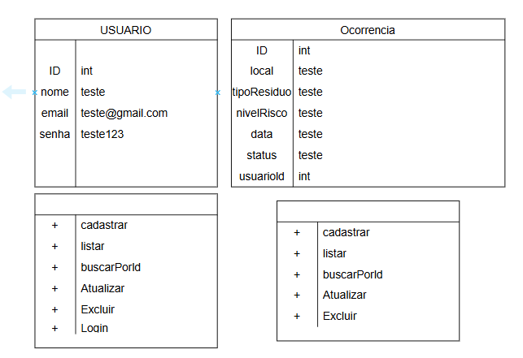

## Tecnologias

- Node.js
- Express
- JavaScript
- MySQL
- mysql2
- Insomnia
- XAMPP
- Visual Studio Code

## Passo a passo para testar

1. Instalar o Node.js.
2. Abrir o projeto no Visual Studio Code.
3. Abrir o terminal na pasta do projeto.
4. Instalar as dependências:

   `npm install`

5. Abrir o XAMPP e iniciar o MySQL.
6. Acessar o phpMyAdmin.
7. Executar o arquivo `db/script.sql` para criar o banco de dados e as tabelas.
8. Iniciar o servidor:

   `npm start`

9. Acessar o endereço:

   `http://localhost:3000`

10. Abrir o Insomnia e realizar os testes das rotas da API.

## Prints dos testes

### 1. Listagem de usuários
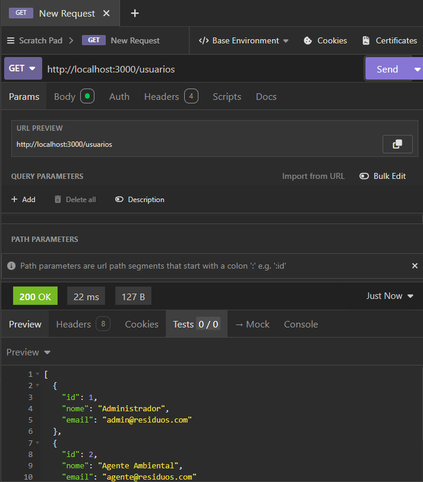

### 2. Busca de usuário por ID
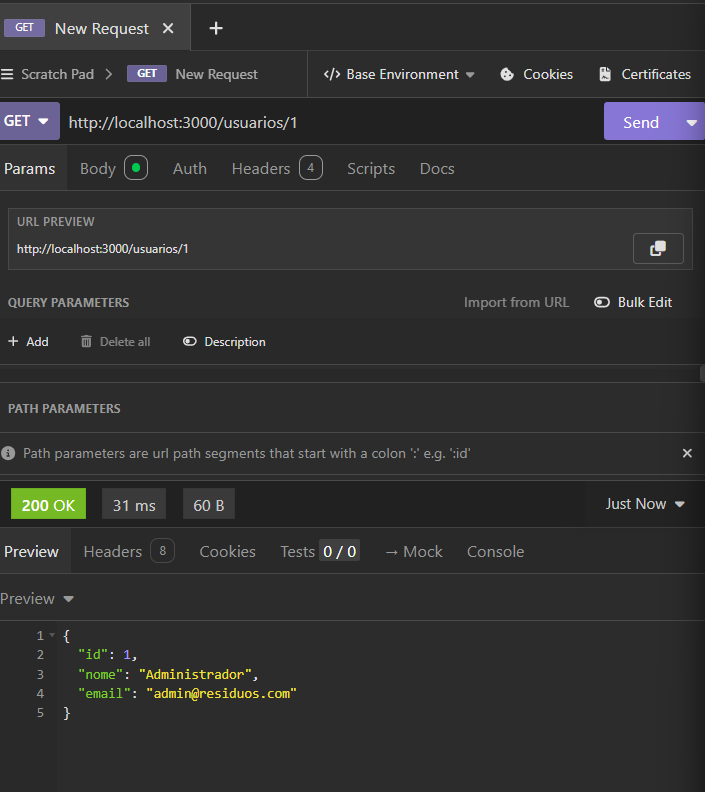

### 3. Cadastro de usuário
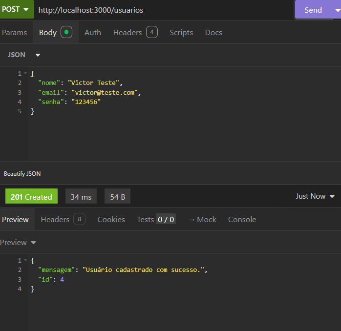

### 4. Atualização de usuário
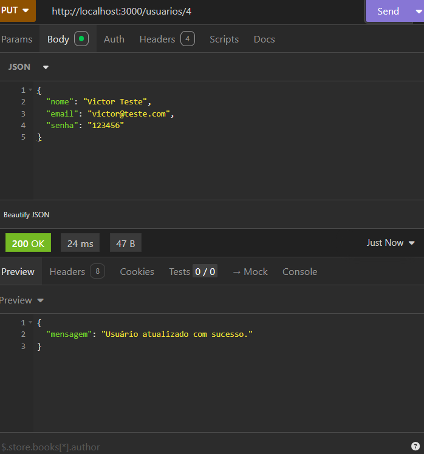

### 5. Exclusão de usuário
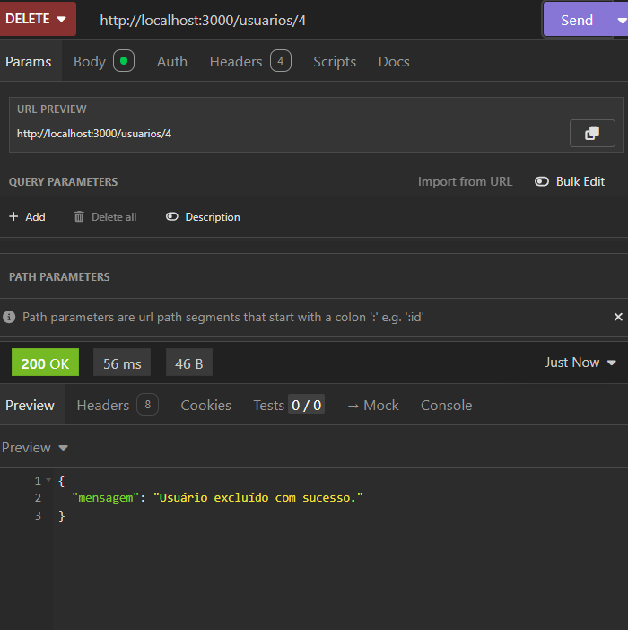

### 6. Login
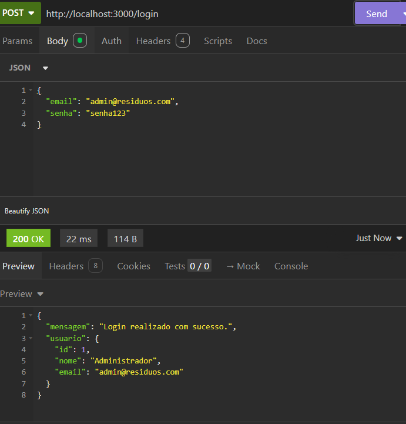

### 7. Listagem de ocorrências
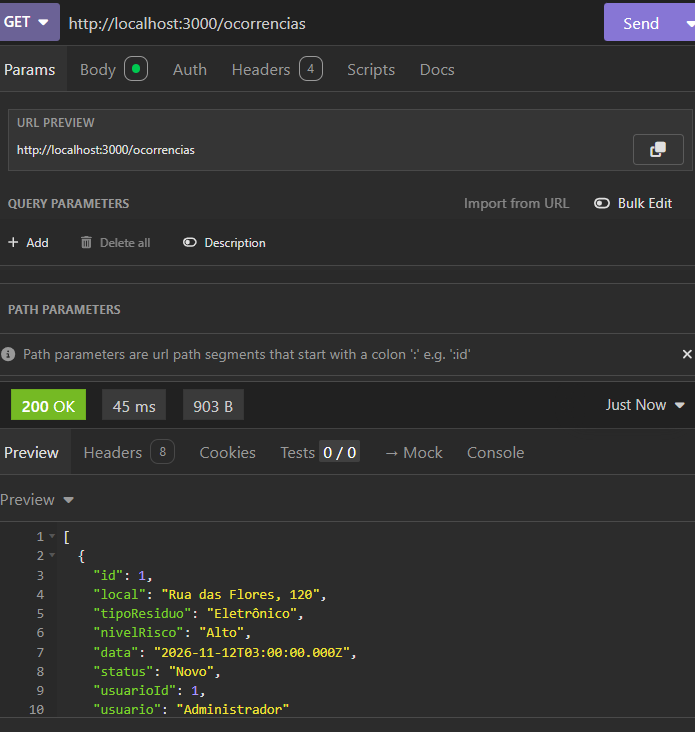

### 8. Busca de ocorrência por ID
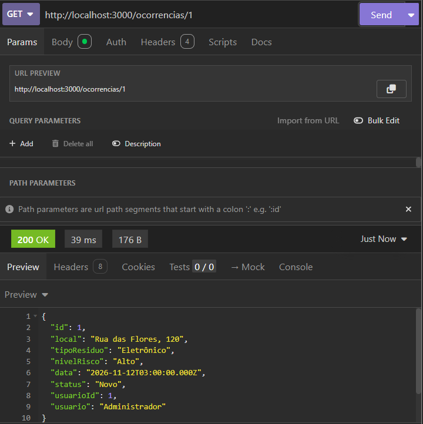

### 9. Cadastro de ocorrência
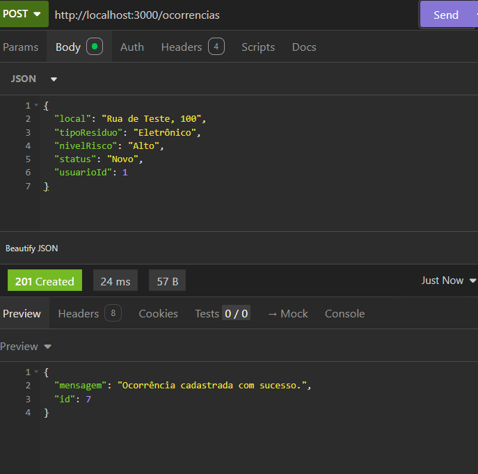

### 10. Atualização de ocorrência
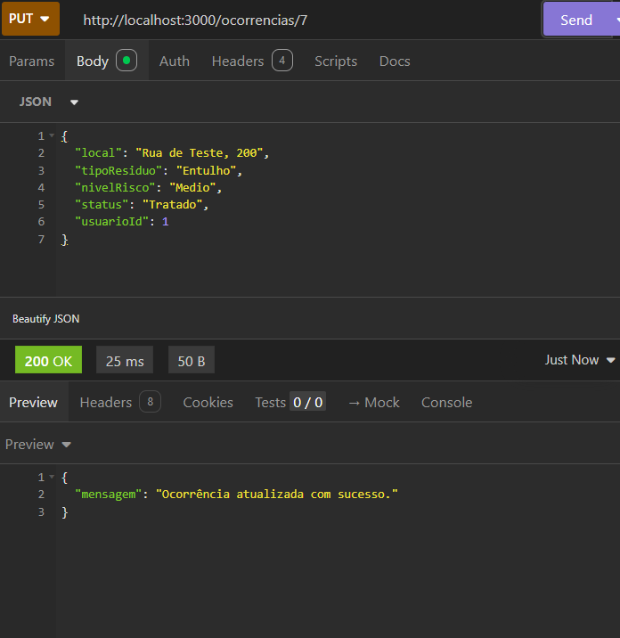

### 11. Exclusão de ocorrência
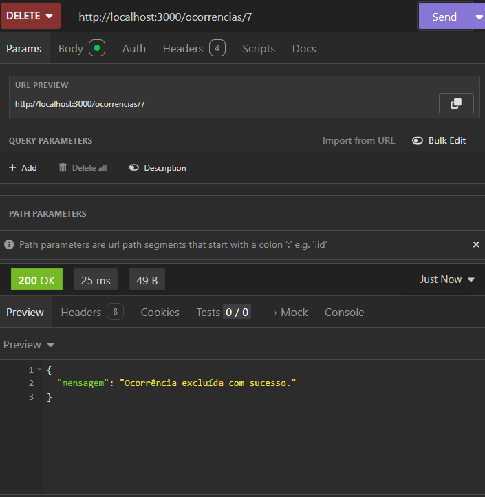

### 12. Resumo das ocorrências
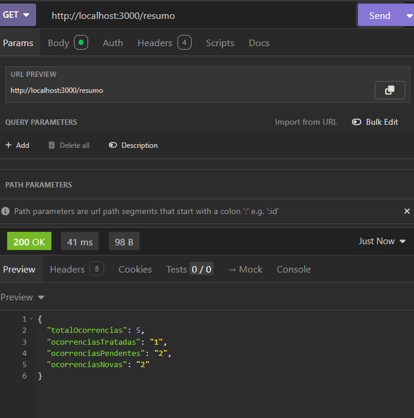